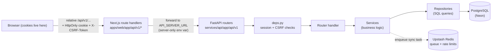
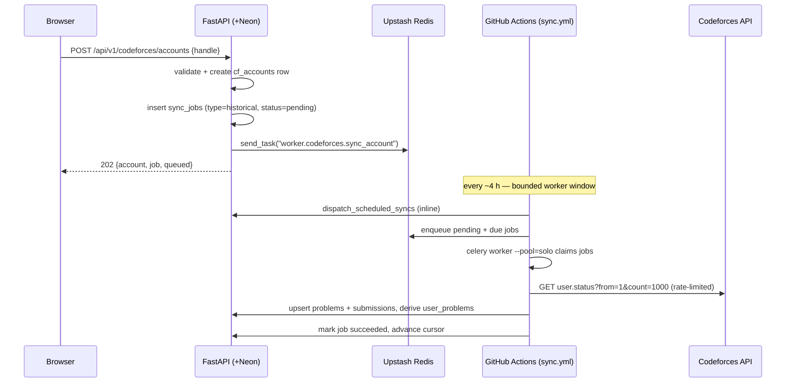
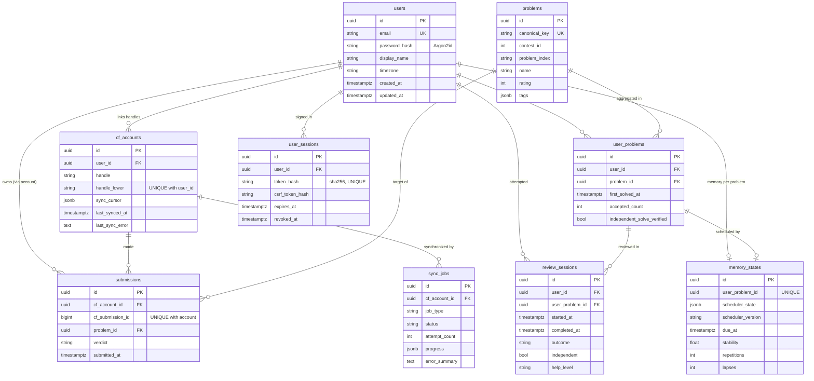
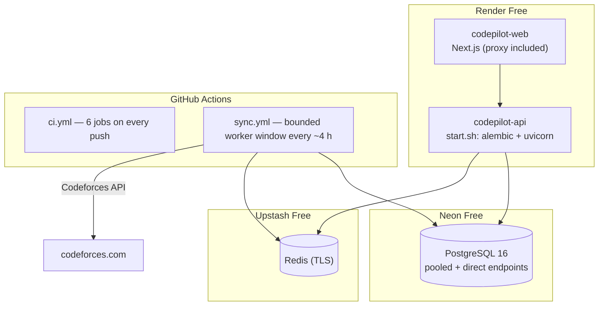

# CodePilot Recall — Study Guide

A guided tour of the entire system for someone who knows how to program but
hasn't built a full-stack application before. Everything here describes the
code that actually exists in this repository at commit `7e13a19` or later —
file paths, function names and behaviors were checked against the source.
Read it alongside the code; every lesson names the exact files to open.

Companion documents: [architecture.md](architecture.md),
[api.md](api.md), [database.md](database.md), [deployment.md](deployment.md),
[testing.md](testing.md), [CHECKLIST.md](CHECKLIST.md) and the ADRs in
[adr/](adr/).

---

## A. Product overview

### The problem

Competitive programmers solve hundreds of problems on
[Codeforces](https://codeforces.com) and then forget them. Re-solving a
forgotten problem is where deep learning happens, but Codeforces has no
memory of *when you learned* something — only when you submitted code.

CodePilot Recall solves this in three steps:

1. **Import** your public Codeforces submission history and keep the date
   each problem was *first accepted* — the true "learned it" date.
2. **Visualize** your practice: activity heatmap, solved-problem table with
   filters, streaks — all timezone-correct.
3. **Schedule revisions** with FSRS (the Free Spaced Repetition Scheduler,
   the algorithm behind Anki's modern scheduler), so problems come back for
   review just before you would forget them.

### Main user journeys

1. **Register** (`/register`) → an account with an Argon2id-hashed password.
2. **Link a handle** (`/onboarding`): enter your public Codeforces handle →
   the API creates a *sync job* → a background worker imports your history.
3. **Dashboard** (`/dashboard`): summary cards, activity heatmap with three
   modes (submissions / first solves / reviews), a filterable solved-problem
   table.
4. **Review** (`/review`): problems whose FSRS due date has arrived, rated
   Again / Hard / Good / Easy after attempting them independently.
5. **Return**: the schedule persists; every review reshapes the next due
   dates.

### What it does and does not do

Does: multi-user accounts with real sessions, public-handle import,
first-solve tracking, timezone-correct analytics, FSRS review scheduling.

Does not (yet): email verification or password reset (no mail provider —
documented in [ADR-0008](adr/0008-auth-sessions-csrf.md)), private contest
or gym imports beyond fallback identities, topic-level analytics, or any
claim of professional security auditing.

---

## B. Technology stack

| Layer | Technology | Why it's here |
| --- | --- | --- |
| Frontend | **Next.js 16** (App Router), **TypeScript** | React framework with file-based routing; the App Router also hosts *route handlers* used as the API proxy (section D). |
| Styling | **Tailwind CSS 4** | Utility-first CSS; the design tokens and shared classes live in `apps/web/app/globals.css`. |
| API | **FastAPI** (Python 3.11+) | Async-friendly Python web framework with automatic request validation and OpenAPI docs. |
| Validation | **Pydantic v2** + pydantic-settings | Declares request/response shapes once; FastAPI enforces them. Settings come from environment variables. |
| ORM | **SQLAlchemy 2** | Python classes mapped to PostgreSQL tables; the repositories query through it. |
| Migrations | **Alembic** | Versioned schema changes (`alembic upgrade head`); five revisions so far. |
| Database | **PostgreSQL 16** (Neon in production) | The single source of truth; all timestamps are timezone-aware UTC. |
| Queue/broker | **Celery 5** + **Redis** (Upstash in production) | Celery runs background jobs; Redis is its broker and the shared rate-limit counter. |
| Scheduler | **FSRS** (`fsrs==6.3.2` behind an adapter) | Computes memory stability, difficulty and next-due dates from review outcomes. |
| Background execution | **GitHub Actions** (scheduled workflow) | In production the worker runs in a bounded ~4-hourly Actions window instead of an always-on server (free tier). |
| Containers | **Docker** (three Dockerfiles) | Identical packaging locally (compose) and in production (Render). |
| Hosting | **Render** (web + API), **Neon** (Postgres), **Upstash** (Redis) | All free plans; see [deployment.md](deployment.md). |
| CI | **GitHub Actions** (`ci.yml`) | Six jobs: API tests on PostgreSQL 16, worker tests, web lint/test/build, compose smoke, backup/restore rehearsal, integrated auth E2E. |

---

## C. Repository map

Read in this order on first contact:

```
codepilot-recall/
├── apps/web/                     # Frontend (Next.js)
│   ├── app/page.tsx              #   landing page (server-rendered)
│   ├── app/api/v1/[...path]/     #   THE PROXY: forwards to FastAPI
│   ├── app/{dashboard,onboarding,review,login,register}/
│   ├── components/               #   UI components (dashboard/, codeforces/, home/, ui/)
│   ├── lib/api.ts                #   fetch wrapper: cookies + CSRF + error envelope
│   ├── lib/auth.ts               #   bootstrapSession / login / register / logout
│   ├── lib/{codeforces,dashboard,reviews}.ts  # typed API calls per domain
│   └── tests/                    #   Vitest (unit) + e2e/ (Playwright)
├── packages/contracts/           # Shared TypeScript types mirroring Pydantic schemas
├── services/api/
│   ├── app/main.py               # App factory, health endpoints, error envelope
│   ├── app/core/                 # config, db engine, logging, rate limit, TLS, URL normalization
│   ├── app/api/deps.py           # session auth + CSRF dependencies (EVERY request passes here)
│   ├── app/api/v1/               # routers: auth, codeforces, dashboard, problems, reviews
│   ├── app/models/               # SQLAlchemy models (user, codeforces, reviews, auth)
│   ├── app/repositories/         # database queries, one module per domain
│   ├── app/services/             # business logic: auth, sync importer, reviews, dashboard, queue
│   ├── app/integrations/         # codeforces/ (client, normalizer) and fsrs/ (adapter)
│   ├── alembic/versions/         # migrations 0001–0005
│   ├── scripts/                  # seed_demo.py, verify_backup.py (CI rehearsal)
│   └── tests/                    # 215 pytest tests
├── services/worker/
│   ├── worker/celery_app.py      # Celery instance, TLS config, beat schedule
│   └── worker/tasks/codeforces.py  # sync_account + dispatch_scheduled_syncs
├── infra/docker/                 # api, web, worker Dockerfiles
├── .github/workflows/            # ci.yml (6 jobs) + sync.yml (scheduled sync)
└── docs/                         # you are here
```

---

## D. Architecture and request flow

The browser **never** talks to the API origin directly. The Next.js server
sits in front of FastAPI as a *same-origin proxy*.



Trace of a real request — "Open dashboard":

1. Browser loads `/dashboard` (a Next.js page) and calls
   `bootstrapSession()` in `apps/web/lib/auth.ts` →
   `GET /api/v1/auth/me` (relative path!).
2. That path matches the catch-all proxy route
   `apps/web/app/api/v1/[...path]/route.ts`, which forwards the request —
   including the session cookie and the `X-CSRF-Token` header — to
   `API_SERVER_URL` (a server-only environment variable; the browser never
   sees it). If the API is asleep (free tier), the proxy retries inside a
   bounded wake window before returning an honest 502 envelope.
3. FastAPI's `get_current_user_id` dependency in
   `services/api/app/api/deps.py` hashes the session cookie with
   SHA-256, looks the hash up in `user_sessions`, and checks expiry,
   inactivity, revocation and user existence. No cookie → 401. Bad cookie
   → 401. There is no fallback.
4. The dashboard router calls `app/repositories/dashboard.py`, which runs
   aggregate SQL and returns rows; the router shapes them with Pydantic
   (`app/schemas/dashboard.py`) and FastAPI serializes to JSON.
5. The proxy copies the response back, including any `Set-Cookie` headers.

**Where Redis fits:** two jobs. (1) It is the Celery broker — sync jobs
travel through it. (2) It backs the fixed-window rate limiter
(`app/core/rate_limit.py`) for registration and login. It is *not* a cache
of dashboard data; everything on the dashboard is computed from PostgreSQL
on read.

---

## E. Authentication and security

All of this is in `services/api/app/services/auth.py`,
`app/api/v1/auth.py` and `app/api/deps.py`, with 34+ tests in
`tests/test_auth_security.py`.

### Registration and login

- `POST /api/v1/auth/register` normalizes the email (lowercase, trimmed via
  `auth.normalize_email`), validates shape and password length, hashes with
  **Argon2id** (`argon2-cffi==25.1.0`, parameters in Settings — ~120 ms at
  the default `m=64MiB, t=2, p=4`), and handles the unique-constraint race
  as a 409. A beta allowlist (`BETA_ALLOWED_EMAILS`) can restrict
  registration to invited addresses with a generic 403.
- `POST /api/v1/auth/login` returns **the same "Invalid email or password."**
  for unknown emails and wrong passwords. For unknown emails it burns one
  Argon2 verification against a dummy hash first, so attackers cannot use
  response timing to discover which emails exist.

### Session tokens — opaque and server-side

- On login the server generates a **256-bit random token**
  (`secrets.token_urlsafe(32)`). The browser receives it in an HttpOnly
  cookie; the database stores only `sha256(token)`. A stolen database dump
  therefore contains no usable bearer tokens.
- `user_sessions` (migration `0005`) records the token hash, a CSRF-token
  hash, `issued_at`, `last_seen_at`, `expires_at` (absolute 30 days) and
  `revoked_at`. Every request re-validates **all** of it in
  `auth.resolve_session` — a cookie's mere presence proves nothing.
- Cookies are `HttpOnly; SameSite=Lax; Path=/` always, plus `Secure` and the
  `__Host-` prefix in production (`__Host-cpr_session`). `__Host-` makes the
  browser refuse the cookie on any other host and forbids a `Domain`
  attribute.
- Logout sets `revoked_at` server-side and deletes the cookie;
  `POST /auth/sessions/revoke-all` revokes every session for the account.

*Protects against:* password theft (Argon2id), database-dump token reuse
(hashed tokens), session fixation (new token per login), silent expiry.
*Does not guarantee:* protection against malware on the user's machine, or
against a compromised browser extension reading same-origin requests.

### CSRF and Origin checks

State-changing requests must echo the session's CSRF token in the
`X-CSRF-Token` header (`require_csrf` in `deps.py`, compared with
`secrets.compare_digest` — a constant-time comparison). The token comes
from `GET /auth/csrf`, which rotates it each call. Independently,
`validate_browser_origin` rejects browser requests whose `Origin`/`Referer`
is not one of the configured `CORS_ORIGINS`. `SameSite=Lax` is defense in
depth, not the primary defense, and GET requests never mutate anything.

*Protects against:* another website making your browser submit actions
while your cookie rides along. *Does not protect:* non-browser clients
(which don't carry cookies cross-site anyway).

### Rate limiting

`app/core/rate_limit.py` implements a fixed-window counter in Redis
(`INCR` + `EXPIRE`), shared across all API workers: registration
`5/hour/IP`, login `10/15min` per IP *and* per normalized email. When Redis
is unreachable in production the endpoint **fails closed** with 503 rather
than silently losing the shared protection. Keys use the socket peer
address — not `X-Forwarded-For`, which any client can spoof unless a
trusted proxy strips it.

### Ownership and multi-user isolation

Authentication answers *who you are*; authorization answers *what you may
touch*. Every repository query in `app/repositories/codeforces.py`,
`reviews.py` and `dashboard.py` filters by `user_id` taken from the
validated session — never from a client-supplied parameter. Accessing
another user's resource returns **404** (not 403) so the API doesn't even
confirm that the resource exists. The tests in `tests/test_codeforces_api.py`,
`test_reviews.py` and `test_queue.py` verify this for every endpoint group.

---

## F. Codeforces synchronization

The full lifecycle, with the files that implement each step:



1. **Linking** — `POST /api/v1/codeforces/accounts`
   (`app/api/v1/codeforces.py`) validates the handle format, enforces the
   per-user quota (`MAX_LINKED_ACCOUNTS`) and creates the account. Note the
   policy: handles are **public data**, so two users may track the same
   handle — uniqueness is `(user_id, handle_lower)` (ADR-0009). Linking is
   not ownership proof.
2. **Job creation** — a `sync_jobs` row with `status=pending` is the
   durable record; `enqueue_sync` (`app/services/sync/queue.py`) then tries
   to hand the task to Redis. If the broker is down the request still
   succeeds: the pending row is the source of truth.
3. **Discovery** — `dispatch_scheduled_syncs`
   (`worker/tasks/codeforces.py`) runs at the start of every Actions
   window: it fails stale `running` jobs (crash recovery), re-enqueues
   `pending` jobs (broker-outage recovery), and creates `incremental` jobs
   for accounts whose `last_synced_at` is older than
   `CF_SYNC_INTERVAL_MINUTES`.
4. **Execution** — `sync_account` claims the job atomically
   (`repo.claim_job`: a conditional `UPDATE`), so duplicate task deliveries
   are harmless. The per-account lock (`lock_account`, `FOR UPDATE`)
   prevents two syncs of one account.
5. **Fetching** — `CodeforcesApiClient`
   (`app/integrations/codeforces/client.py`) calls `user.info` (validate
   handle) and pages through `user.status` with
   `from=/count=1000` parameters, through the shared rate limiter (2.5 s
   between requests), with bounded exponential backoff + jitter on 5xx and
   `Retry-After` on 429. A `FAILED` envelope raises — it is never mistaken
   for "no submissions".
6. **Normalization & persistence** — `app/integrations/codeforces/normalizer.py`
   converts timestamps (`creationTimeSeconds` → tz-aware UTC), verdicts and
   problems into rows; `SyncImporter._process_page`
   (`app/services/sync/importer.py`) upserts them. Idempotency: submissions
   are unique per `(cf_account_id, cf_submission_id)`, so re-importing a
   page updates existing rows instead of duplicating them.
7. **Derivation** — after the walk, `recompute_user_problems`
   (`app/repositories/codeforces.py`) rebuilds `user_problems` from the
   accepted submissions: `first_solved_at = MIN(submitted_at WHERE
   verdict='OK')`. Min-semantics means discovering an older solve moves the
   date *earlier* — never later.
8. **Accounting** — the job row gets `succeeded`, a progress dict and the
   cursor `{last_seen_submission_id}` — but **only after** every page
   succeeded. A failed page leaves the job `failed` + `last_sync_error`
   with pages already committed (per-page commits make retries cheap).
9. **Incremental sync** — the walk pages newest-first and stops as soon as
   a full page contains nothing new ("known-page stop"); page 1 always
   re-fetches recent submissions so verdict updates (e.g. `TESTING → OK`)
   propagate. The cursor is a safety net, not the ordering mechanism —
   submission IDs are never treated as timestamps.

The production wrinkle: there is no always-on worker. The Celery worker
runs inside a bounded GitHub Actions window (`.github/workflows/sync.yml`):
migrate → dispatch → `timeout 12m celery worker --pool=solo`. A killed
window is safe (acks-late requeues in-flight tasks) and the concurrency
group prevents overlapping windows. Consequence: a "Sync now" click runs at
the next window, up to ~4 hours later — the UI says so honestly.

---

## G. Database schema

Five migrations built it (`services/api/alembic/versions/`): `0001` users,
`0002` Codeforces tables, `0003` activity indexes, `0004` reviews + FSRS,
`0005` auth sessions + shared-handle policy.



Why it is shaped this way:

- **`problems` are shared.** One row per canonical problem
  (`canonical_key = "{contestId}-{index}"`), because every user's
  submissions point at the same public problem. Identity never changes;
  descriptive fields (rating, tags) refresh on re-sync.
- **`submissions` are immutable events** keyed by the source ID, while
  **`user_problems` are derived rollups** keyed by `(user_id, problem_id)`.
  That split is what makes re-imports idempotent: counting submissions
  twice changes nothing, because uniqueness collapses them.
- **`first_solved_at` lives in the rollup**, computed with `MIN()` over
  accepted submissions — so a later resubmission can never move it forward.
- **Indexes match the queries** (migration `0003`):
  `submissions(cf_account_id, submitted_at)` for heatmap windows and
  `user_problems(user_id, first_solved_at)` for recency scans.
- **`user_sessions` stores hashes, not tokens** — see section E.

---

## H. Dashboard

Everything on the dashboard is **computed on read** from the canonical
tables — there is deliberately no `daily_activity` summary table
(ADR-0005). Reasons:

1. A stored per-day rollup is only valid for *one* timezone; a user
   changing their timezone would invalidate every stored row. Deriving at
   query time converts each UTC timestamp to the requested IANA zone first.
2. Correctness of invalidation is hard (older solves discovered on re-sync
   move `first_solved_at` backwards across days). Deriving from unique-
   constrained source rows is exact by construction: **repeated syncs
   cannot inflate counts because the unique constraints collapse
   duplicates.**
3. The data volume (a user's own submissions) is small enough that indexed
   scans are fast; heatmap ranges are capped at 731 days
   (`MAX_HEATMAP_DAYS`).

Flow: `GET /api/v1/dashboard/summary?timezone=…`
(`app/api/v1/dashboard.py`) → `app/repositories/dashboard.py` → totals +
recent first-solves + account statuses; the streak is computed in
`app/services/dashboard.py` from local-date buckets of the last 400 days.

The heatmap endpoint takes `from`, `to`, `timezone` and `mode`
(`submissions` / `first_solves` / `reviews`) and returns a *continuous*
list of local dates including zero-activity days
(`build_continuous_days`). Timezone correctness is the subtle part: a
submission at 23:30 UTC is "yesterday" for a user in New York and "today"
in Kolkata — `bucket_by_local_date` converts every timestamp with
`zoneinfo` before assigning the local date, and tests pin both boundary
directions.

The solved-problem table extends this with server-side filtering
(`search`, `rating_min/max`, `tag`), a validated sort whitelist
(`SORTABLE_PROBLEM_FIELDS` — anything else is a 422) and pagination. The
tag filter matches whole tags only (quote-wrapped JSON text match), so
`two` doesn't match `two-pointers`.

---

## I. Reviews and FSRS

A Codeforces acceptance and a successful review are **different events**.
The import can tell you *that* you solved something; only an honest review
attempt tells you *whether you still remember it*. That's why linking a
handle never creates review data — `independent_solve_verified` starts
`false` and no `memory_states` row exists until your first explicit review.

Lifecycle (`app/services/reviews.py`):

1. `POST /api/v1/reviews/sessions {problem_id}` — creates a `pending`
   `review_sessions` row for a problem you have solved.
2. You attempt the problem on Codeforces, then
   `POST .../sessions/{id}/complete` with `outcome` (again/hard/good/easy),
   `independent` and `help_level` (none/hint/editorial). The mapping is:
   Again = forgot or needed substantial help; Hard = heavy struggle or a
   small hint; Good = independent with effort; Easy = independent, fast,
   confident (ADR-0006). `independent` and `help_level` are recorded
   separately from the FSRS rating — an editorial-assisted solve is never
   independent recall.
3. Completion is transactional and idempotent: the row is locked
   (`FOR UPDATE`), a repeat completion returns **409** and never advances
   the scheduler twice, and the review row + memory state commit together —
   a crash between them rolls back both.
4. The FSRS adapter (`app/integrations/fsrs/adapter.py`) wraps
   `fsrs==6.3.2`. The card is serialized into
   `memory_states.scheduler_state` as JSON with a
   `scheduler_version` marker, so a restart (or future package upgrade)
   reconstructs exactly the same memory. Corrupt state raises instead of
   silently resetting your history.
5. `due_at` from FSRS is authoritative. The **queue urgency layer**
   (`app/services/queue.py`) sits on top: tiers Critical (≥30 days
   overdue) / High (≥7 d) / Overdue (≥24 h) / Due (inside the grace
   window), ordered by tier → most overdue → lowest stability → problem
   key. It only ranks and labels; it never rewrites a due date.
6. **Retrievability** — `adapter.retrievability()` asks the FSRS scheduler
   for its estimate of current recall probability at a point in time. It is
   a *model estimate*, always labeled as such in the UI, `null` when no
   valid history exists, and computed without mutating anything.

The Reviews heatmap mode counts **completed** sessions (status = completed,
bucketed by local date). Started-but-abandoned sessions never count.

---

## J. APIs and contracts

Every route is declared in `services/api/app/api/v1/` (routers) with
Pydantic request/response models in `app/schemas/`. The frontend mirrors
them in `packages/contracts/src/index.ts` — a type-only npm workspace
package imported by both web code and tests.

| Group | Endpoints | Purpose |
| --- | --- | --- |
| Auth | `POST /auth/register`, `POST /auth/login`, `POST /auth/logout`, `GET /auth/me`, `GET /auth/csrf`, `GET /auth/sessions`, `POST /auth/sessions/revoke-all` | Account + session lifecycle |
| Codeforces | `POST /codeforces/accounts`, `GET /codeforces/accounts`, `POST /codeforces/accounts/{id}/sync`, `GET /codeforces/accounts/{id}/sync-status` | Link handles, trigger syncs, observe jobs |
| Dashboard | `GET /dashboard/summary?timezone=`, `GET /dashboard/heatmap?from&to&timezone&mode` | Aggregates |
| Problems | `GET /problems?search&rating_min&rating_max&tag&sort&order&page&page_size` | Solved-problem table |
| Reviews | `POST /reviews/sessions`, `GET /reviews/sessions/{id}`, `POST /reviews/sessions/{id}/complete`, `GET /reviews/due?mode=due\|upcoming`, `GET /reviews/history` | Review lifecycle + queue |
| Meta | `GET /health`, `GET /health/ready`, `GET /api/v1/` | Liveness, readiness, metadata |

Every error — validation, auth, not-found, conflict, rate limit — uses one
envelope, registered as exception handlers in `app/main.py`:

```json
{ "error": { "code": "http_409", "message": "…", "details": null } }
```

On the frontend, `apps/web/lib/api.ts` wraps `fetch` with `credentials:
"include"`, attaches the CSRF header to mutations, retries once after a
CSRF rotation, and converts failures into an `ApiError` (status + code +
message). Domain helpers in `lib/codeforces.ts`, `lib/dashboard.ts` and
`lib/reviews.ts` are thin typed wrappers; `lib/auth.ts` manages the session
bootstrap. The TypeScript contracts in `packages/contracts` are hand-maintained
to mirror the Pydantic schemas — update both sides together.

---

## K. Deployment and operations

Two environments, one codebase:

**Local (Docker Compose):** `docker compose up --build` starts Postgres 16,
Redis, the API (its command runs `alembic upgrade head` first), a Celery
worker + beat, and the Next.js web app. The API talks to `postgres` and
`redis` by hostname; the worker is always-on. See
[deployment.md](deployment.md).

**Production (free tier):**



Key operational facts (all detailed in [deployment.md](deployment.md)):

- **Proxying:** `API_SERVER_URL` is server-only; the browser bundle is
  built with an empty `NEXT_PUBLIC_API_BASE_URL`, and CI greps the built
  bundle to prove no localhost origin leaked in.
- **Migrations at startup:** the API container CMD runs
  `scripts/start.sh` — Alembic with `DIRECT_DATABASE_URL` (Neon direct
  endpoint, bypassing PgBouncer for DDL), stopping the deploy on failure,
  then `exec uvicorn` on Render's `$PORT`. Keep Render's **Docker Command**
  field empty — an override once broke the deploy with exit 127.
- **The worker window** (`sync.yml`): bounded to 12 minutes, solo pool,
  runs migrations first, then dispatch + drain. A killed window is safe
  (acks-late requeues); overlapping windows are prevented by a concurrency
  group.
- **Health checks:** `/health` (liveness) and `/health/ready` (database).
  Render's deploy probe uses the latter.
- **CI:** six jobs on every push — API tests (PostgreSQL 16 service), worker
  tests, web lint/unit/build plus a client-bundle localhost check, compose
  build & smoke, a real backup/restore rehearsal (pg_dump → pg_restore →
  integrity verification), and an integrated auth E2E against a live API.
- **Free-tier reality:** web/API instances sleep and take ~30–60 s to wake
  (the proxy's wake-retry window hides most of this); Neon suspends
  compute; Upstash meters commands per day. The scheduled sync may also be
  delayed by GitHub's queue — run the workflow manually when needed.
- **Logs:** structured JSON from the API and worker; Render keeps runtime
  and deploy logs separately. Auth audit events never include credentials
  or tokens.

---

## L. Testing

Where things live and what each layer proves (counts as of `7e13a19`):

| Suite | Location | Proves |
| --- | --- | --- |
| API pytest (215) | `services/api/tests/` | Endpoint behavior on **real PostgreSQL 16** (CI service container), auth/session/CSRF semantics, FSRS scheduling, importer idempotency, queue ranking, URL normalization, migration drift (`alembic check`), backup/restore round-trip (via `scripts/seed_demo.py` + `verify_backup.py`) |
| Worker pytest (13) | `services/worker/tests/` | Celery task execution with fakes, dispatcher recovery, TLS config, duplicate-delivery safety |
| Web Vitest (56) | `apps/web/tests/` | Components and pages with stubbed fetch: session states, queue labels, form validation, error/empty states |
| Playwright (8) | `apps/web/e2e/` | Real browser against the dev server: pages render, honest unreachable states |
| Integrated auth E2E (3) | `apps/web/e2e/auth/` via `playwright.auth.config.ts` | Register/login/logout through the real API and proxy, two-user isolation |
| CI `sync.yml` | root | The worker drains a real broker; runs every ~4 h |

Not covered automatically, and how it was covered instead: the first live
Codeforces import (verified manually by the repository owner in
production). Still open: long-term sync reliability, and security review
beyond the automated tests.

The key testing pattern to learn from: **the database is SQLite in local
tests and PostgreSQL 16 in CI** — same code, same engine factory
(`app/core/db.py`), so schema bugs surface in CI. One known consequence:
SQLite reloads timestamps without timezone info, which the code and tests
normalize explicitly.

---

## M. Guided code-reading curriculum

Work top to bottom. Each lesson ends with a checkpoint question — answer it
from the code before moving on.

### Lesson 1 — The map

- **Objective:** know where everything lives and how the parts connect.
- **Read:** this guide §C; `README.md`; `apps/web/app/page.tsx`;
  `services/api/app/main.py`.
- **Concepts:** monorepo workspaces (npm) vs multi-service repo (pip);
  server components vs client components; app factory pattern.
- **Exercise:** find where the string `CodePilot Recall` appears in the
  rendered landing page and where the API's name appears in its health
  response. Trace both back to their source.
- **Checkpoint:** which two directories contain the code that runs when a
  user opens `/dashboard`?

### Lesson 2 — Configuration and environments

- **Objective:** understand 12-factor configuration with pydantic-settings.
- **Read:** `services/api/app/core/config.py`;
  `services/worker/worker/config.py`; `.env.example`.
- **Concepts:** `BaseSettings`, `lru_cache` on `get_settings()`, the
  `NoDecode` annotation (why `CORS_ORIGINS` and `BETA_ALLOWED_EMAILS` need
  it), case-insensitive env mapping.
- **Exercise:** add a temporary `print(settings.cf_status_page_size)` after
  installing the package locally and run `python -c` with
  `CF_STATUS_PAGE_SIZE=7` in the environment. Remove the print afterwards.
- **Checkpoint:** why does changing `REDIS_URL` between tests require
  `get_settings.cache_clear()`?

### Lesson 3 — The same-origin proxy

- **Objective:** understand why the proxy exists and how forwarding works.
- **Read:** `apps/web/app/api/v1/[...path]/route.ts`;
  `apps/web/app/api/v1/health/route.ts`; `apps/web/lib/api.ts`.
- **Concepts:** first-party cookies vs third-party; hop-by-hop headers;
  multi-valued `Set-Cookie`; wake-retry window vs per-attempt timeout.
- **Exercise:** run `docker compose up api` locally, then
  `curl -i http://localhost:3000/api/v1/health` (with the web running) and
  compare with `curl -i http://localhost:8000/health`.
- **Checkpoint:** why would baking `http://localhost:8000` into the client
  bundle break production? (Hint: the CI job "Client bundle must not bake a
  localhost API origin".)

### Lesson 4 — Database models and migrations

- **Objective:** read SQLAlchemy models and understand the schema's shape.
- **Read:** `services/api/app/models/base.py`, `user.py`, `codeforces.py`,
  `reviews.py`, `auth.py`; migrations `0001`–`0005`.
- **Concepts:** `UUIDPrimaryKeyMixin`/`TimestampMixin`; unique constraints
  as behavior (idempotency); `ondelete` cascades; `JSON().with_variant(...)`
  portability; why indexes match query patterns.
- **Exercise:** run `alembic upgrade head` on a scratch SQLite file, then
  open it with any SQLite browser and list the tables and their unique
  constraints.
- **Checkpoint:** which constraint makes repeated imports of the same
  submission harmless?

### Lesson 5 — Sessions and password security

- **Objective:** trace a login end to end and explain every defense.
- **Read:** `services/api/app/services/auth.py`;
  `app/api/v1/auth.py`; `app/models/auth.py`.
- **Concepts:** Argon2id parameters; timing equalization; token hashing;
  absolute vs inactivity expiry; revocation; the dummy-hash trick for
  unknown emails.
- **Exercise:** register a user against a local API, then query the
  `user_sessions` table and confirm the cookie value appears nowhere in it.
- **Checkpoint:** what exactly is stored in `user_sessions.token_hash`, and
  why not the token itself?

### Lesson 6 — CSRF and Origin validation

- **Objective:** understand the synchronizer-token pattern.
- **Read:** `services/api/app/api/deps.py` (`require_csrf`,
  `validate_browser_origin`); `apps/web/lib/api.ts`
  (`ensureCsrfToken`, retry logic).
- **Concepts:** why cookies alone are vulnerable to cross-site requests;
  constant-time comparison; why GET/HEAD are exempt; why a missing Origin
  header is allowed (non-browser clients).
- **Exercise:** with the local stack running, POST to
  `/api/v1/codeforces/accounts` from a terminal without the CSRF header and
  observe the 403 envelope.
- **Checkpoint:** why is `SameSite=Lax` alone not sufficient?

### Lesson 7 — Codeforces client and normalization

- **Objective:** learn the integration layer's shape: client, normalizer,
  errors.
- **Read:** `services/api/app/integrations/codeforces/client.py`,
  `normalizer.py`; the tests in `tests/test_cf_client.py` and
  `test_cf_normalizer.py`.
- **Concepts:** envelope validation; retry with exponential backoff +
  jitter; honoring `Retry-After`; canonical problem identity.
- **Exercise:** trace what happens to a submission with
  `verdict: "TESTING"` — where is it stored, and does it count as solved?
- **Checkpoint:** why does a `FAILED` API envelope raise instead of
  returning an empty list?

### Lesson 8 — The sync importer

- **Objective:** understand idempotent persistence and first-solve
  derivation.
- **Read:** `services/api/app/services/sync/importer.py`;
  `app/repositories/codeforces.py` (`upsert_problems`,
  `upsert_submissions`, `recompute_user_problems`).
- **Concepts:** per-page commits; cursor only on full success; min-
  semantics for `first_solved_at`; known-page stop for incremental syncs.
- **Exercise:** run the importer tests
  (`tests/test_importer.py::test_earlier_discovery_moves_first_solved_back_not_forward`)
  and trace the SQL the rollup performs.
- **Checkpoint:** a user re-syncs and Codeforces returns an older accepted
  submission than any stored one. What happens to `first_solved_at`, and
  which line of code guarantees it?

### Lesson 9 — Background jobs without an always-on worker

- **Objective:** understand Celery task semantics and the Actions-window
  deployment.
- **Read:** `services/worker/worker/celery_app.py`,
  `worker/tasks/codeforces.py`; `.github/workflows/sync.yml`;
  `services/api/app/services/sync/queue.py`.
- **Concepts:** broker vs backend; `acks_late`; solo pool; concurrency
  groups in Actions; why the API only *enqueues*.
- **Exercise:** run the dispatcher inline locally
  (`dispatch_scheduled_syncs.run()`) against a scratch database and inspect
  the returned counters.
- **Checkpoint:** the broker is down when a user clicks "Sync now". What
  does the user see, and what happens to the job?

### Lesson 10 — Derived dashboard aggregates

- **Objective:** understand compute-on-read analytics and timezone
  handling.
- **Read:** `services/api/app/repositories/dashboard.py`,
  `app/services/dashboard.py`, `app/api/v1/dashboard.py`;
  `docs/adr/0005-derive-activity-on-read.md`.
- **Concepts:** local-date bucketing with `zoneinfo`; continuous date
  ranges; the 400-day streak window; why there is no `daily_activity`
  table.
- **Exercise:** call the heatmap endpoint for two timezones with a
  timestamp near UTC midnight and compare the `days` arrays.
- **Checkpoint:** a user changes their timezone from UTC to Kolkata. Which
  stored rows must be updated? (Trick question — explain.)

### Lesson 11 — FSRS reviews

- **Objective:** understand the review lifecycle and the FSRS adapter
  boundary.
- **Read:** `services/api/app/integrations/fsrs/adapter.py`,
  `app/services/reviews.py`, `app/api/v1/reviews.py`;
  `docs/adr/0006-review-lifecycle-and-outcome-policy.md`.
- **Concepts:** serialized scheduler state + version; idempotent
  completion; lapse counting; urgency vs scheduling; retrievability as an
  estimate.
- **Exercise:** complete a review locally, then inspect the
  `memory_states.scheduler_state` JSON and find the FSRS card fields
  inside.
- **Checkpoint:** a second completion request arrives for the same
  session. Which two things prevent the scheduler from advancing twice?

### Lesson 12 — The review queue

- **Objective:** understand the urgency layer that ranks the queue.
- **Read:** `services/api/app/services/queue.py`; the `due` endpoint in
  `app/api/v1/reviews.py`; the tests in `tests/test_queue.py`.
- **Concepts:** tier thresholds; deterministic tiebreakers; why ranking
  never mutates scheduling; `null` retrievability meaning.
- **Exercise:** change `QueuePolicy.critical_after_seconds` in a scratch
  run and re-run `tests/test_queue.py::test_priority_tiers_by_overdue_duration`
  to see the boundary move.
- **Checkpoint:** why is a corrupt `scheduler_state` ranked normally in the
  queue but refused on completion?

### Lesson 13 — The frontend data layer

- **Objective:** see how the browser talks to the API without duplicated
  logic.
- **Read:** `apps/web/lib/api.ts`, `lib/auth.ts`, `lib/codeforces.ts`;
  `packages/contracts/src/index.ts`.
- **Concepts:** relative paths through the proxy; CSRF auto-acquisition and
  retry; the tri-state session bootstrap; shared types as the contract.
- **Exercise:** change a field name in a contracts interface and observe
  the TypeScript errors appear in the pages that use it. Revert.
- **Checkpoint:** where does the CSRF token come from, and what happens if
  the server rotated it since the page loaded?

### Lesson 14 — Testing strategy

- **Objective:** learn what each suite proves and how to run them.
- **Read:** `docs/testing.md`; `services/api/tests/conftest.py`;
  `apps/web/tests/auth-harness.ts`; `scripts/seed_demo.py`.
- **Concepts:** SQLite-vs-PostgreSQL engine swapping; fixture seeding via
  the importer; eager Celery; Playwright configs (standard vs integrated).
- **Exercise:** run all four suites locally and note the total runtime of
  each.
- **Checkpoint:** which suite would catch a broken unique constraint on
  `submissions`, and why can't the Vitest suite do that?

### Lesson 15 — Deployment and operations

- **Objective:** connect the code to the running system.
- **Read:** `docs/deployment.md`; `infra/docker/api.Dockerfile`;
  `services/api/scripts/start.sh`; `.github/workflows/ci.yml` and
  `sync.yml`.
- **Concepts:** start.sh gating; direct vs pooled Neon URLs; bounded
  worker windows; the backup/restore rehearsal.
- **Exercise:** open the Actions tab and read the latest *Scheduled sync*
  run's job log from the top; identify each phase (migrate, dispatch,
  drain) in the output.
- **Checkpoint:** why does the production API image need Celery installed
  even though it never *runs* a worker?

---

## N. Glossary and debugging guide

### Glossary

- **Same-origin proxy** — Next.js route handlers that forward browser
  requests to the API so all cookies are first-party
  (`apps/web/app/api/v1/`).
- **Sync job** — a `sync_jobs` row tracking one import/sync run of one
  account (`historical`, `incremental`, `reconcile`).
- **Cursor** — `cf_accounts.sync_cursor.last_seen_submission_id`; a safety
  net recorded only after a fully successful import.
- **First solve** — the earliest accepted submission timestamp for a
  (user, problem); never moves forward.
- **FSRS / memory state** — the scheduler's model of one user-problem:
  stability, difficulty, due date; serialized in `memory_states`.
- **Retrievability** — FSRS's estimated probability of recall right now; a
  model estimate, not a measurement.
- **Queue urgency tier** — Critical/High/Overdue/Due; ranking only, never
  scheduling.
- **CSRF token** — per-session secret proving a mutation came from our own
  frontend.
- **Dev auth boundary** — the retired `X-User-Id` header (replaced by real
  sessions in Phase 5; see ADR-0004/0008).
- **Beta gate** — `BETA_ALLOWED_EMAILS` allowlist restricting registration.

### Symptom → debugging guide

| Symptom | Likely subsystem | Files to inspect | Safe debugging steps |
| --- | --- | --- | --- |
| Login returns 401 for a real account | Sessions | `app/services/auth.py` (`resolve_session`), `user_sessions` table | Check `expires_at`/`revoked_at`/`last_seen_at` for the row; confirm the cookie name matches the environment (`__Host-` prefix in production) |
| 401 on every user-data endpoint | Auth dependency | `app/api/deps.py` | Confirm a cookie was sent at all; check the API's `ENVIRONMENT` (production requires a valid session) |
| 403 with "Invalid or missing CSRF token" | CSRF | `app/api/deps.py`, `apps/web/lib/api.ts`, `/auth/csrf` | Verify the mutation carried `X-CSRF-Token`; fetch `/api/v1/auth/csrf` fresh and retry (tokens rotate) |
| 403 "Untrusted origin" | Origin check | `CORS_ORIGINS` setting, `validate_browser_origin` | Compare the browser's `Origin` header with the configured list; it must match exactly |
| Registration says "limited to invited beta testers" | Beta gate | `BETA_ALLOWED_EMAILS` | Add the address (normalized lowercase) to the Render env var and redeploy |
| Sync stuck in `pending` | Queue/dispatcher | `worker/tasks/codeforces.py` (`dispatch_scheduled_syncs`), `sync_jobs.status` | Run the *Scheduled sync* workflow manually; check the broker `REDIS_URL` and the API logs for "enqueue failed" |
| Sync `failed` with a Codeforces error | Upstream/limits | `app/integrations/codeforces/client.py`, job `error_summary` | Read `error_summary`; check for rate-limit wording; wait for the next window or retry manually |
| Sync shows `No module named 'celery'` | Packaging (fixed) | `services/api/pyproject.toml` | Already fixed (commit a0d62bf); if it recurs, confirm `celery==5.6.3` is still in the API dependencies and the Render deploy is current |
| Import succeeded but dashboard is empty | Frontend/aggregates | `app/repositories/dashboard.py`, browser network tab | Check `/api/v1/dashboard/summary` directly; confirm the account's `user_id` matches the logged-in session |
| Heatmap dates look shifted one day | Timezone bucketing | `app/services/dashboard.py` (`bucket_by_local_date`), the `timezone` query param | Compare a specific submission's UTC time vs the bucketed local date; verify the requested IANA name is correct |
| Review due date looks too soon/late | FSRS state | `memory_states.scheduler_state`, `app/integrations/fsrs/adapter.py` | Decode the card JSON; check `due_at` vs the last review and outcome; remember learning steps are minutes, review intervals are days |
| 502 `api_unreachable` in the UI | Free-tier cold start | `apps/web/lib/api-proxy.ts`, Render logs | Wait ~1 minute for the instance to wake and retry; if persistent, check Render runtime logs |
| Render deploy fails with port-scan timeout | Startup | `services/api/scripts/start.sh`, Render **Docker Command** override | Confirm the override field is EMPTY; check runtime logs for the `[start]` echo lines and Alembic output |
| GitHub Actions sync run failed | Worker window | `.github/workflows/sync.yml`, job log | Read which step failed (migrate / dispatch / drain); `timeout 12m` exit 124 on the drain step is the normal bounded-window path |

---

## Verification status of this guide

Every file path, function name, endpoint and behavior cited here was
checked against the repository at commit `7e13a19` while writing it
(2026-10-25). Production claims (deployment, the successful import, the
completed scheduled-sync run, the invited tester) are stated as reported by
the repository owner, not independently re-verified from this workspace.
The curriculum exercises are meant to be your verification: doing them is
the fastest way to confirm this guide against reality — and to stop needing
the guide at all.
